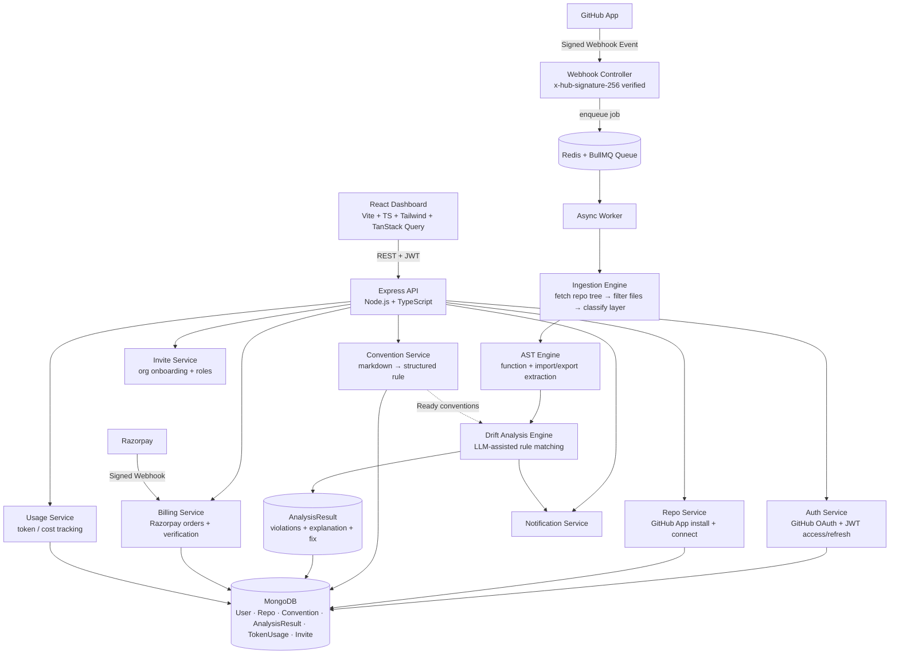
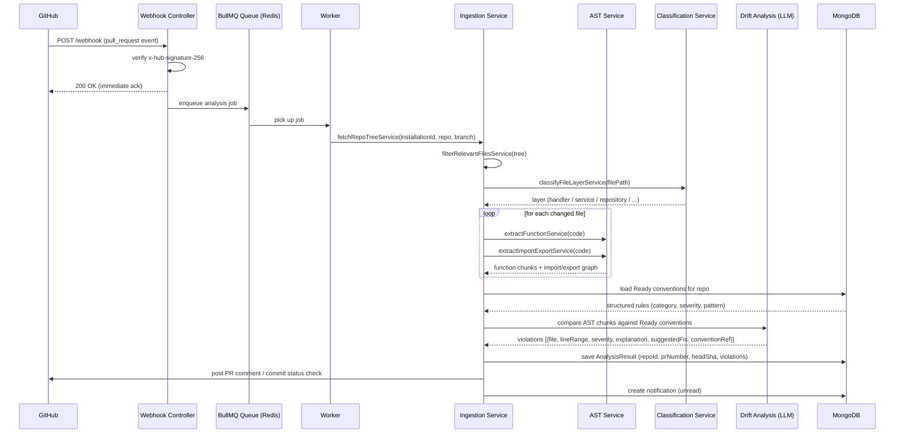
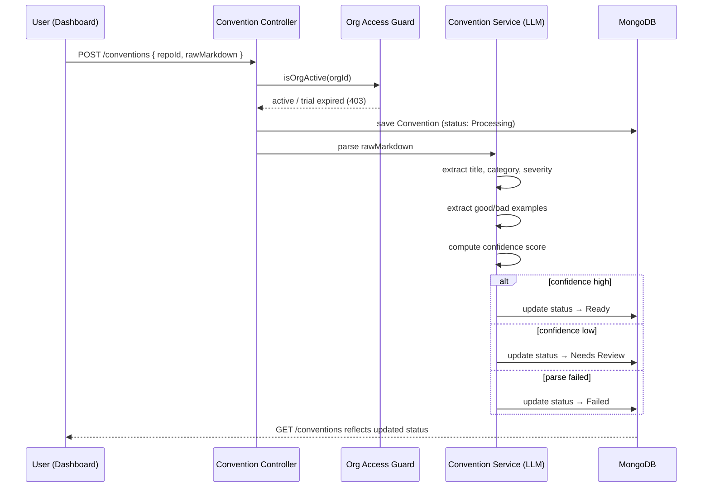
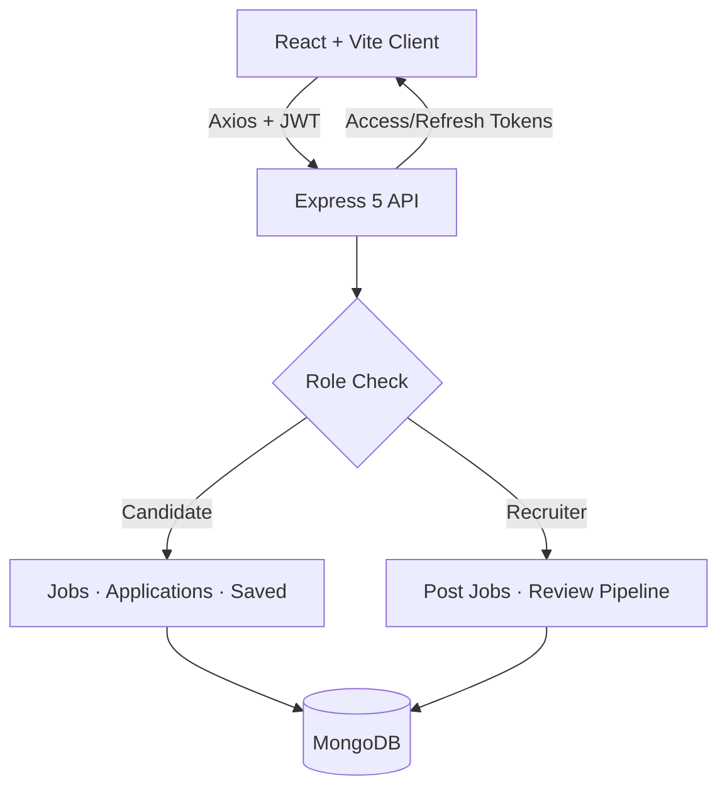
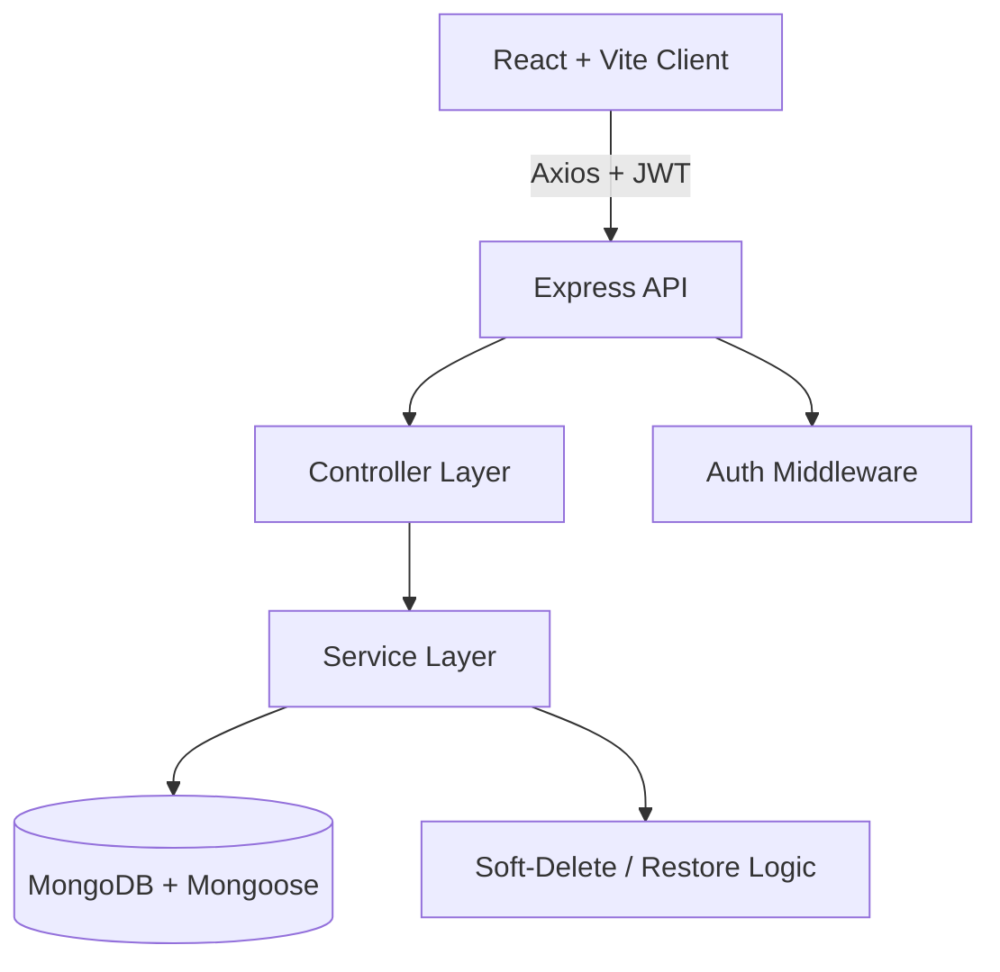
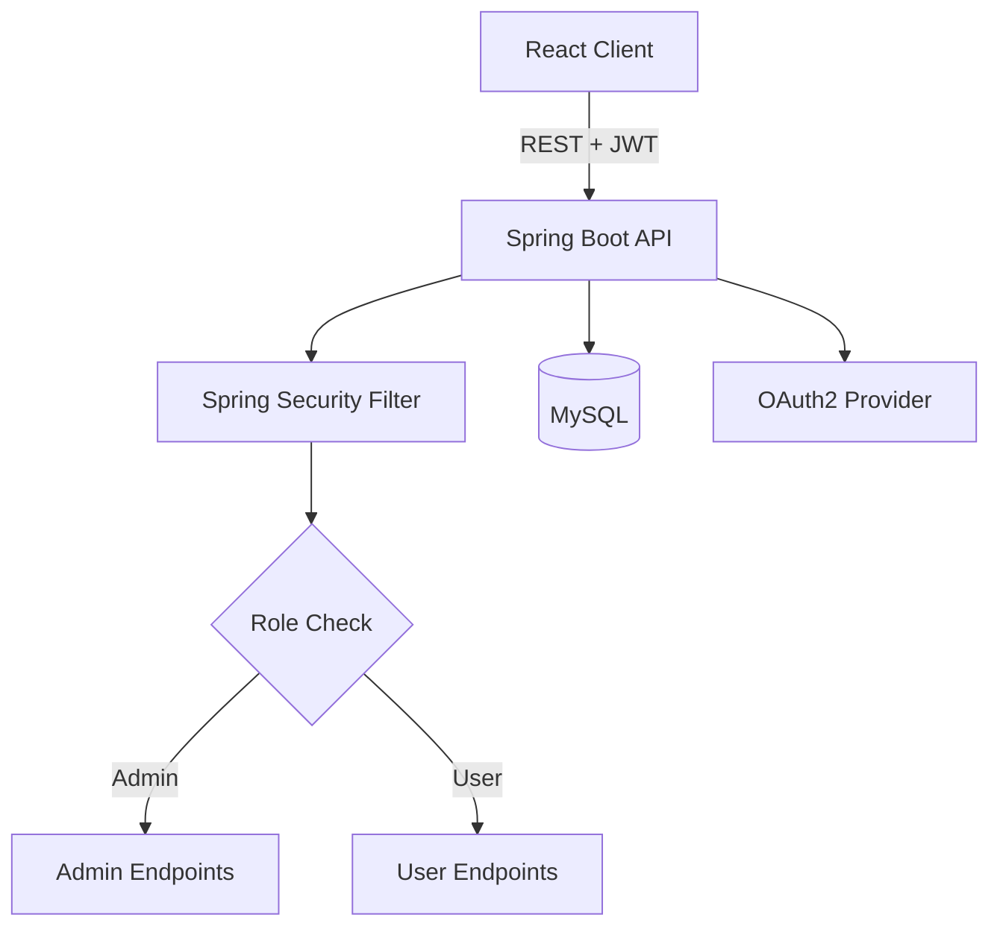

<!-- ============================================================
     🌌 3D ANIMATED HEADER — Blinkit × Meesho × Purple Theme
     ============================================================ -->
<div align="center">
  
</div>

<p align="center">
  
</p>

<p align="center">
  <a href="https://www.linkedin.com/in/sanjayjaidev"></a>
  <a href="mailto:sanjayk.dev.ai@gmail.com"></a>
  <a href="https://x.com/SanjayJava6006"></a>
  <a href="https://github.com/fullspectrum-dev"></a>
  
</p>

<div align="center">

|  |  |  |  |  |
|:---:|:---:|:---:|:---:|:---:|
| 🚀 **Founding Engineer @ Femxo** | 🛡️ **Building DriftGuard — AI Code Governance** | ⚡ **Ex- Senergetic · Ex- SAG Infotech** | 🧠 **225+ DSA Problems Solved** | 🎓 **BCA — Grad 2026** |

</div>

---

## 👋 About Me

> *"I don't just write code — I build systems that scale."*

I'm currently a **Founding Engineer @ Femxo Consultancy Service Pvt Ltd** — a **Bihar-based startup**, working **100% remotely** — where I'm building **Femxo end-to-end** using **MERN + GenAI + Java**, with a **cross-tech architecture** spanning **PostgreSQL, MongoDB, Redis, and more**.

Before Femxo, I shipped production platforms as a **Software Engineer at Senergetic Pvt Ltd (Remote)** — building **Grocery/Commerce and College management** systems with **MERN + GenAI** — and before that, I worked as a **Java Backend Developer at SAG Infotech Pvt Ltd (On-site)**, shipping REST APIs and working inside Agile teams.

I've grown from **Java backend → full-stack MERN → GenAI-powered backend systems**, and I'm currently deep in **LLM-backed platforms** — building **DriftGuard**, an AI code-governance tool that parses code with ASTs and uses an LLM to catch architectural drift on pull requests.

I believe in **learning by building** — every concept I study turns into a project, a PR, or a bug fixed in production.

```
🚀  Currently         → Founding Engineer @ Femxo Consultancy Service Pvt Ltd (Remote · Bihar, India)
🏗️  Building at work  → Femxo end-to-end — MERN + GenAI + Java + PostgreSQL (cross-tech)
⚡  Previously         → Senergetic Pvt Ltd (Remote · MERN + GenAI · Grocery & College platforms)
☕  Previously         → SAG Infotech Pvt Ltd (On-site · Java Backend · REST APIs · Agile)
🛡️  Building (side)   → DriftGuard (AI code governance / drift detection SaaS)
🧩  Shipped            → HireFlow (role-based recruitment platform, MERN)
🌱  Learning           → LLM orchestration, queue-based system design, cross-tech architecture
💬  Ask me about       → React, Node.js, Java, Spring Boot, GenAI, System Design
⚡  Fun fact            → I debug faster with chai ☕ than coffee
```

---

## 💼 Experience

<table>
<tr>
<td width="33%" valign="top">

### 🚀 Founding Engineer
**Femxo Consultancy Service Pvt Ltd**
<br/>
`Aug 2025 — Present` · *Remote · Bihar, India*


- Building **Femxo end-to-end** — from architecture to deployment — using **MERN + GenAI + Java**
- Owning **cross-tech architecture** (PostgreSQL, MongoDB, Redis, queues) across parallel product lines
- Shipping AI-assisted backend services, prompt pipelines, and LLM orchestration
- Founding-engineer scope: product, infra, code, and delivery

</td>
<td width="33%" valign="top">

### ⚡ Software Engineer
**Senergetic Pvt Ltd**
<br/>
`2024 — 2025` · *Remote*


- Shipped **Grocery/Commerce** and **College Management** platforms end-to-end
- Built fast-turnaround production features on MERN stack
- Integrated GenAI-backed flows into backend services
- Worked across fast-moving parallel requirements

</td>
<td width="33%" valign="top">

### ☕ Java Backend Developer
**SAG Infotech Pvt Ltd**
<br/>
`2023 — 2024` · *On-site*


- Shipped **REST APIs** in Java/Spring Boot
- Worked in **Agile** teams with sprint-driven delivery
- Built clean Controller → Service → Repository layers
- Contributed to backend stability and API contracts

</td>
</tr>
</table>

---

<!-- 3D gradient wave divider -->


## 🛡️ Flagship Project — DriftGuard

<p align="left">
  
  
  
</p>

**DriftGuard is an AI-powered code governance platform that catches architectural drift on GitHub pull requests before they merge.**

Teams write their engineering conventions in plain markdown ("handlers must not call the database directly," "always wrap errors," etc.). DriftGuard parses that markdown into a structured rule using an LLM, then checks every pull request's diff against it — using AST-based code parsing, not regex — and reports back the exact file, line range, a plain-language explanation, and a suggested fix.


**Core Capabilities**
- 🔐 GitHub OAuth login + GitHub App installation flow to connect repositories
- 📝 Markdown-to-rule engine — conventions are parsed into category, severity, confidence score, and good/bad examples
- 🌳 AST-based code analysis — function-level extraction and import/export extraction, not text matching
- 🗂️ File ingestion pipeline — fetches the repo tree, filters relevant files, and classifies each file's architectural layer
- ⚙️ Webhook-driven async pipeline — GitHub webhook events are signature-verified, acknowledged instantly, and processed in the background via **Redis + BullMQ**
- 🤖 LLM-assisted violation detection — violations returned with an explanation and a suggested fix, not just a flag
- 📊 Drift analytics — per-repo violation trends over time, plus AI token usage and cache-hit tracking per organization
- 💳 Razorpay-based billing — trial gating, plan upgrades, and signature-verified payment webhooks
- 👥 Org-based multi-tenancy — admin-controlled invites and role assignment

**[View Repository →](https://github.com/fullspectrum-dev/driftguard)**

<br/>

<details open>
<summary><b>🏗️ High-Level Design (HLD)</b></summary>
<br/>



</details>

<details>
<summary><b>🔩 Low-Level Design (LLD) — PR Analysis Pipeline</b></summary>
<br/>



</details>

<details>
<summary><b>🔩 Low-Level Design (LLD) — Convention Parsing Pipeline</b></summary>
<br/>



</details>

<br/>

<div align="center">

### 🎥 Live Video Demo

<a href="#">
  
</a>

*See DriftGuard connect a repo, parse a markdown convention into a structured rule, and flag a live architectural violation on a real pull request — end to end.*

</div>

---

<!-- 3D gradient wave divider -->


## 🔥 Other Projects

### 💼 HireFlow — Full-Stack Recruitment Platform

<table>
<tr>
<td width="55%" valign="top">

**A role-aware hiring platform connecting candidates and recruiters through one clean workflow.**


**Key Features**
- 🔐 JWT auth with refresh token rotation + role-based access control
- 🔍 Job listing with pagination, filters, debounced search
- 📝 Apply flow with duplicate-apply conflict handling
- 📊 Candidate & Recruiter dashboards with pipeline funnel charts
- 🌗 Centralized dark/light theme system

**[View Repository →](https://github.com/fullspectrum-dev/hireflow)**

</td>
<td width="45%" valign="top">



</td>
</tr>
</table>

---

### 🗂️ TeamBoard — Project Management App

<table>
<tr>
<td width="55%" valign="top">

**A full-stack task & project tracker built for small teams to plan, assign, and ship work.**


**Key Features**
- 📋 Project & task CRUD with soft-delete and restore
- 👤 Shared layout with avatar dropdown & theme toggle
- 📈 CSS-only donut chart dashboard for progress tracking
- 🔐 JWT-protected routes with `ProtectedRoute` guard
- 🌗 Centralized dark/light theme system

**[View Repository →](https://github.com/fullspectrum-dev/teamboard)**

</td>
<td width="45%" valign="top">



</td>
</tr>
</table>

---

### 🔐 Full-Stack Authentication System

<table>
<tr>
<td width="55%" valign="top">

**A production-grade auth system built with a security-first mindset.**


**Key Features**
- 🔑 JWT auth with access & refresh token expiry handling
- 🌐 OAuth2 login — Google / GitHub
- 🛡️ Spring Security role-based access control (ADMIN / USER)
- ⚠️ Global exception handling with custom error responses
- 🗄️ Optimized MySQL queries with proper indexing
- 🧱 Clean Controller → Service → Repository architecture

**[View Repository →](https://github.com/fullspectrum-dev/full-stack-Authentication-App-)**

</td>
<td width="45%" valign="top">



</td>
</tr>
</table>

---

> 📌 *DriftGuard is under active development — billing, drift analytics and the AST engine are shipped; more is on the way.*

---

<!-- 3D gradient wave divider -->


## 🛠️ Tech Stack

<div align="center">

**Frontend**
<br/>


<br/><br/>

**Backend**
<br/>


<br/><br/>

**Database & Cache**
<br/>


<br/><br/>

**DevOps & Tools**
<br/>


<br/><br/>

**GenAI & LLM Engineering**
<br/>

<br/><br/>


<br/><br/>


<br/><br/>

**Vector Databases**
<br/>


</div>

---

<!-- 3D gradient wave divider -->


## 📊 GitHub Stats

<div align="center">
  
  
</div>

<div align="center">
  
</div>

---

<!-- 3D gradient wave divider -->


## 📈 Contribution Graph

<div align="center">
  
</div>

<div align="center">
  
</div>

---

<!-- 3D gradient wave divider -->


## 🏆 GitHub Trophies

<div align="center">
  
</div>

---

<!-- 3D gradient wave divider -->


## ⚡ LeetCode & GeeksForGeeks

<div align="center">
  <table border="0" cellspacing="0" cellpadding="0">
    <tr>
      <td align="center" style="padding: 15px;">
        
        <br/><br/>
        
        
        
      </td>
      <td align="center" style="padding: 15px;">
        
        <br/><br/>
        
        
      </td>
    </tr>
  </table>
</div>

---

<!-- 3D gradient wave divider -->


## 🌱 Currently Learning

<div align="center">

| Track | Status |
|---|---|
| 🤖 RAG (Retrieval-Augmented Generation) | 🚧 In Progress |
| 🧬 Embeddings & Semantic Search | 🚧 In Progress |
| 🗄️ Vector Databases (Pinecone, ChromaDB, FAISS) | 🚧 In Progress |
| 🔗 LangChain / LlamaIndex Frameworks | 🌱 Learning |
| ✍️ Prompt Engineering & Fine-Tuning | 🌱 Learning |
| 🐘 PostgreSQL — Advanced Queries & Indexing | 🚧 In Progress |
| 🧠 DSA — Two Pointers, Fast & Slow | ✅ Completed |
| 🧠 DSA — Sliding Window | 🚧 In Progress |
| 🧠 DSA — Intervals, Heaps, Top-K, K-way Merge | ⏭️ Upcoming |
| 🏗️ System Design — HLD/LLD, CAP theorem | 🌱 Learning |
| 📦 Kubernetes | 🌱 Learning |
| 📐 Design Patterns (GoF) | 🌱 Learning |

</div>

---

<!-- 3D gradient wave divider -->


## 🤝 Connect With Me

<p align="center">
  <a href="https://www.linkedin.com/in/sanjayjaidev">
    
  </a>
  <a href="mailto:sanjayk.dev.ai@gmail.com">
    
  </a>
  <a href="https://x.com/SanjayJava6006">
    
  </a>
  <a href="https://github.com/fullspectrum-dev">
    
  </a>
</p>

<div align="center">
  <i>Open to remote Full Stack / Backend roles at startups — let's build something great together.</i>
</div>

---

<!-- ============================================================
     🌌 3D ANIMATED FOOTER — Blinkit × Meesho × Purple Theme
     ============================================================ -->
<div align="center">
  
</div>
